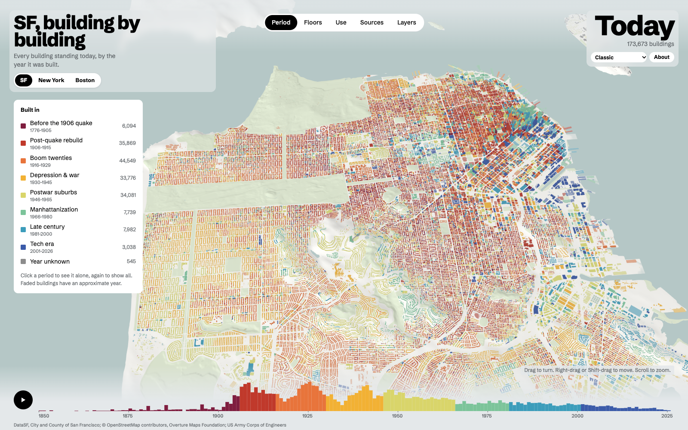

# A city, building by building

A 3D map of every building in San Francisco, the Bay Area, New York and Boston, coloured by the
year it was built, its height, its use or the source of its date.

- **Data:** built from open data by a Rust pipeline.
- **Rendering:** threers, a Rust/wgpu three.js replacement compiled to WebAssembly. WebGPU, with
  a WebGL2 fallback.
- **Hosting:** served by a small Rust API server, or as a static site (GitHub Pages).



| Directory | What it holds |
|---|---|
| `crates/pipeline/` | `pipeline <city> <step>`: downloads, joins, cleans and tiles a city into `web/data/<city>/`; `pipeline site` builds the static site. Data format: [`crates/pipeline/FORMAT.md`](crates/pipeline/FORMAT.md) |
| `crates/tilefmt/` | the tile binary format (SFT5; SFT6 adds floating parts and dome/onion/pyramid roofs), shared by the pipeline and the API |
| `crates/api/` | one server for the app, the data and a JSON API with user marks in SQLite ([`crates/api/README.md`](crates/api/README.md)) |
| `landmarks/` | hand-built 3D models of landmarks, with their generators ([`landmarks/README.md`](landmarks/README.md)) |
| `layers/` | occupancy layers (academia, startups, companies) per city ([`layers/SCHEMA.md`](layers/SCHEMA.md)) |
| `data-private/` | ignored local-only occupancy layers; created and read by the pipeline |
| `web/` | the browser app (plain ES modules, no bundler) |
| `cache/` | raw downloads (not published) |

## Quick start

```sh
cargo run --release -p pipeline -- sf all     # fetch .. compress; also bay, nyc, boston
web/sync-threers.sh                           # build threers into web/threers{,-gl}/
web/serve.sh                                  # http://localhost:8123/?city=sf (0.0.0.0, API server)
web/serve.sh --static                         # files only: no API, marks kept in the browser
```

The pipeline steps, in order, are `fetch`, `join`, `years`, `ground`, `tiles`, `layers`,
`verify` and `compress`. `all` runs them all. Rerun `compress` after any step that rewrites
`web/data/<city>/`.

Push `main` to publish on GitHub Pages through Actions. To build the same artifact locally, run
`cargo run --release -p pipeline -- site`. See [`docs/PUBLISHING.md`](docs/PUBLISHING.md). Cities with
sources for local use only (the Bay Area) are left out unless `--include-local` is given.

Tests: `cargo test -p api -p tilefmt`. In the browser: `node web/tools/shoot.cjs --city sf`
(screenshots, errors and frame times) and `node web/tools/layers-test.cjs`.

## Using the map

- **Modes:** Period, Floors, Use, Sources, Layers (who occupied a building, and when; you can add
  your own marks).
- **Timeline:** drag it to go back in time, or press play to watch the city grow. In New York,
  buildings demolished since 1996 stand until the year they came down (NYC Building Footprints
  Historic); earlier demolitions are not in any open dataset the map uses. A demolished building
  with no construction year gets the median year of the dated buildings around it that were up
  before it came down (shown faded, as approximate).
- **Buildings:** hover for a card; click to keep it open.
- **Animation:** dragging the timeline glides the year, so buildings grow (and demolished ones
  darken and sink) instead of popping; play gives each year time by how much was built in it,
  with buildings of one year rising at staggered moments, pale until they are up. Switching mode
  cross-fades the colours; a period toggled in the legend rises or sinks (`tools/anim-check.cjs`
  captures these mid-way).
- **Colour scheme:** the picker under the year. The choice is remembered.

### Colour schemes (`web/schemes.js`)

| Scheme | Look |
|---|---|
| Classic | the LAYRS look: a white model under a pale sky, the period colours from the city's manifest |
| Colour-blind safe | periods on viridis (ordered by lightness), uses and sources from the Okabe–Ito and Paul Tol sets |
| Night | dark ground and sky, with brighter palettes so the oldest periods still read |

Each scheme sets the sky, land, water, parks, the UI's CSS colours and the palette of every mode.
Year sources get 26 distinct colours, enough for the Bay Area's 22. Occupancy layer colours come
with the layers and are the same in every scheme. To add a scheme, add an entry to `SCHEMES`.
For a dark one, also add its UI colours under `:root[data-scheme=…]` in `styles.css`, so the page
does not flash light before `app.js` runs.

### URL parameters

| Parameter | Effect |
|---|---|
| `city=sf\|bay\|nyc\|boston` | the city |
| `mode=period\|floors\|use\|source\|layers` | the starting mode |
| `scheme=classic\|colorblind\|night` | the colour scheme, for this visit |
| `#x,z,distance,azimuth,elevation` | the camera, in metres and degrees (the address bar keeps it up to date) |
| `gl=1` | WebGL2 instead of WebGPU |
| `inline` | render on the page instead of in a worker (no OffscreenCanvas) |
| `lod=0\|1\|2` | pin full, simplified or overview building geometry (normally automatic) |
| `msaa=1\|4` | pin MSAA; default 1× on high-density screens and 4× otherwise |
| `ss=1` | supersampling off. Default: 1.5× on screens under 2×, lowered if frames get slow |
| `static` | ignore the API server even when there is one |
| `noshadow`, `flat`, `noterrain` | no sun shadows, no relief, no terrain |
| `budget=` | the most GPU vertices kept loaded (default 9e6) |
| `film=` | the length of the play animation, in seconds |
| `debug` | per-pack timings in the console |

## How it renders

- **Render worker:** the map's canvas is handed to a worker (`transferControlToOffscreen`), which
  runs threers and owns the scene, the materials and every mesh (`render-worker.js`,
  `render-core.js`). The page keeps the interface, the camera controls, picking and the timeline,
  and talks to the renderer through `gfx.js`: one message a frame with what changed (camera,
  uniforms, ground, shadow box). The worker draws when the page's frame message arrives, in step
  with the display, and on its own loop if the page is busy. `?inline` renders on the page
  instead (also the fallback where a worker cannot get a GPU device).
- **Parse workers to the GPU:** each parse worker gets a port to the render worker, so a pack's
  mesh goes straight there; the page only receives the picking data (and builds nothing).
- **Uploads:** pack meshes come in pieces of at most 120 k vertices, added under 150 k vertices
  and 6 ms a frame: threers creates GPU buffers on a mesh's first draw, which would otherwise stall
  that frame.
- **Picking:** each pack's pick grid is built in its parse worker; the page only stores it.
- **Ground worker:** `terrain-worker.js` holds the terrain grid, fetches and decodes its tiles,
  meshes each at the detail the page asks for (by distance), and drapes the land / water / park
  polygons on it, in pieces for the upload budget; the meshes go straight to the render worker.
  The page keeps only the tile list.
- **Timeline histogram:** drawn in its own worker on an OffscreenCanvas (`hist-worker.js`), and
  only when what it shows changes.
- **Render on demand:** frames are drawn only while something changes (camera, year, colours,
  meshes) and for 1.2 s after, for the shaders' animations; a still map draws nothing.
- **Motion quality:** while the user moves the camera or plays the timeline, raster detail and
  MSAA drop to 1×; full resolution and the screen's normal MSAA return 220 ms after motion ends.
- **Start-up:** `index.html` creates the render worker before `app.js` has loaded, and it fetches
  and compiles the renderer straight away; at set-up it compiles every material's pipelines with
  an invisible triangle, while the first packs are still on the network (first draw 27 → 15 ms).

New York (8.9 M vertices), on this machine: ready in 0.42–0.5 s; while loading, no main-thread
task over 50 ms (was four, about 400 ms); turning the camera, 0–1 frames in 120 over 20 ms (was
5–26); the page uses about 40–50 MB instead of 250 MB.

## How it loads

- **Early downloads:** the city's manifest, the renderer's wasm and the packs in view are fetched
  in parallel from `index.html` onwards.
- **Workers:** a pool parses packs before the GPU is up.
- **Order:** packs inside the view frustum load nearest first (`web/view.js`), then a margin
  around the view.
- **Building detail:** nearby packs use full extrusions, district views simplify footprints and
  curved roofs, and regional views reduce curved roofs to their minimum segments. Packs are
  reparsed when the camera crosses a detail boundary.
- **Ground:** terrain tiles and land/water/park polygons wait until the first buildings are in.
  They are fetched, meshed and draped in the ground worker (above).
- **Caching:** data URLs carry a content version, so they are cached for good. A static site's
  service worker (`web/sw.js`) serves repeat visits from disk.

At 50 Mbit/s with nothing cached, the first view is ready in about 1.0–1.3 s for SF and 1.2–1.6 s for
New York (static site).

